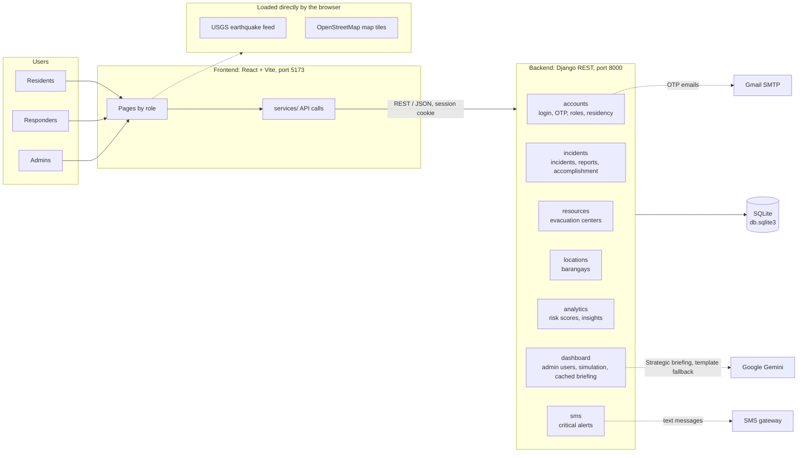
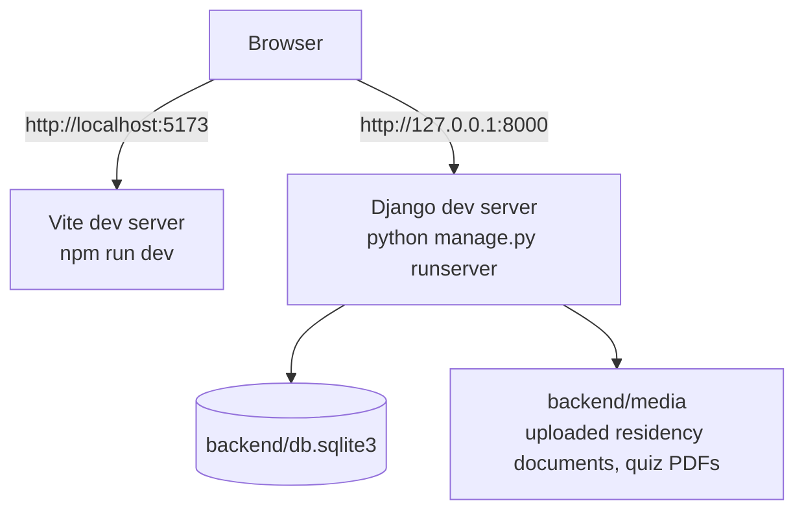

# System Architecture

## Overview

- The browser talks only to the Django API, except for earthquake data (USGS) and map tiles (OpenStreetMap), which it loads directly.
- Login uses Django sessions. The backend only accepts requests from `localhost:5173` and `127.0.0.1:5173` (CORS and CSRF settings in `backend/config/settings.py`).
- The admin dashboard's Strategic Quarterly Briefing uses incidents from the last 30 days and is cached for 30 days. If Gemini is not configured or fails, deterministic template text is used.

## Running Environment

The system currently runs locally. Each team member has their own database.

`db.sqlite3` and `.env` are not stored in Git. `media/` should not be either, because it holds residents' uploaded documents.