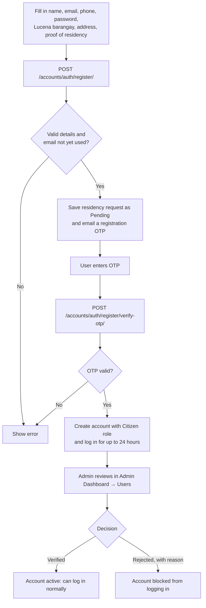
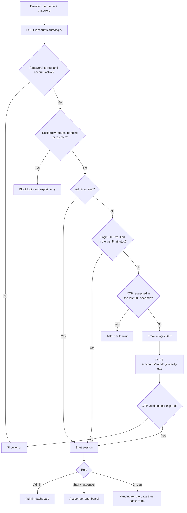
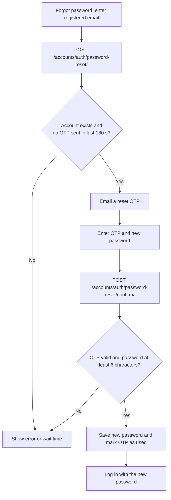

# Authentication Flow

One login page (`/login`) for all roles. Citizens confirm logins with an email OTP; admins and staff skip the OTP. Citizens must also be verified as Lucena City residents by an admin.

| Rule | Value |
|---|---|
| OTP length / validity | 6 digits, valid for 3 minutes |
| Wait before requesting a new OTP | 180 seconds |
| Skip OTP if a login OTP was verified recently | within 5 minutes |
| Session right after registration (residency still pending) | 24 hours |
| Residency proof upload | JPG or PNG, up to 5 MB |

Code: `backend/accounts/views.py`, `frontend/src/services/auth.ts`, `frontend/src/pages/auth/`.

## Citizen Registration and Residency Verification

## Login

## Password Reset

