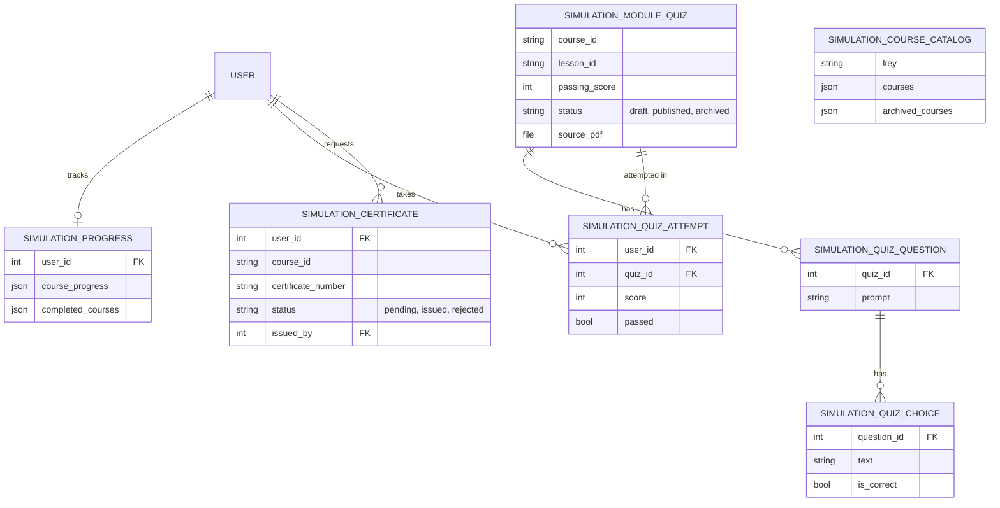

# Database ERD

Main tables only, with their key fields. Full definitions are in each app's `models.py`.

## Accounts, Incidents, and Resources

```mermaid
erDiagram
    USER ||--|| ACCOUNT_PROFILE : has
    USER ||--o| RESIDENCY_VERIFICATION : "submits (citizens)"
    USER ||--o{ INCIDENT_REPORT : "creates (responders)"
    USER ||--o{ INCIDENT : reports
    USER ||--o{ ACCOMPLISHMENT_REPORT : compiles

    BARANGAY ||--o{ INCIDENT : "located in"
    BARANGAY ||--o{ INCIDENT_REPORT : "located in"
    BARANGAY ||--o{ EVACUATION_CENTER : "located in"
    BARANGAY ||--o{ BARANGAY_RISK_SCORE : scored
    BARANGAY ||--o{ HAZARD_PREDICTION : predicted

    HAZARD_TYPE ||--o{ INCIDENT : classifies
    HAZARD_TYPE ||--o{ HAZARD_PREDICTION : "predicted type"

    INCIDENT ||--o| INCIDENT_TYPE_DETAILS : "has one of"
    INCIDENT ||--o{ SMS_LOG : "alerts sent"

    INCIDENT_REPORT ||--o{ VICTIM_DETAIL : lists
    INCIDENT_REPORT }o--o{ ACCOMPLISHMENT_REPORT : "compiled into"

    USER {
        int id PK
        string username
        string email
        bool is_superuser
        bool is_staff
        bool is_active
    }
    ACCOUNT_PROFILE {
        int user_id FK
        string role "admin, staff, citizen"
        string phone_number
    }
    RESIDENCY_VERIFICATION {
        int user_id FK
        string barangay_name
        string residential_address
        file proof_document
        string status "pending, verified, rejected"
        int reviewed_by FK
    }
    ONE_TIME_PASSWORD {
        string email
        string purpose "register, login, password reset"
        string code_hash
        datetime expires_at
        bool is_used
    }
    BARANGAY {
        uuid id PK
        string name
        decimal latitude
        decimal longitude
        json boundary
    }
    HAZARD_TYPE {
        uuid id PK
        string name "Fire, Crime, Drowning, ..."
    }
    INCIDENT {
        uuid id PK
        string reference_code "INC-YYYY-NNN"
        uuid hazard_type_id FK
        uuid barangay_id FK
        decimal latitude
        decimal longitude
        datetime incident_datetime
        string severity_level "low to critical"
        string status "reported to resolved"
    }
    INCIDENT_TYPE_DETAILS {
        uuid incident_id FK
        string note "fire_details, vehicular_accidents, crime_reports, medical_emergencies, drowning_incidents, earthquake_details"
    }
    INCIDENT_REPORT {
        uuid id PK
        string report_code "IR-YYYY-NNNNN"
        string incident_code "INC-YYYY-NNNNN"
        string incident_type
        string responder_team
        uuid barangay_id FK
        decimal latitude
        decimal longitude
        int victim_count
        string action_taken
        string status "Pending, Approved"
        datetime created_at
    }
    VICTIM_DETAIL {
        uuid incident_report_id FK
        string name
        string age
        string gender
        string condition
    }
    ACCOMPLISHMENT_REPORT {
        uuid id PK
        string compiled_code "AR-YYYY-NNNNN"
        int total_reports
        int compiled_by FK
    }
    EVACUATION_CENTER {
        uuid id PK
        string name
        decimal latitude
        decimal longitude
        int capacity
        int current_occupancy
        string status "available, full, closed, maintenance"
        uuid barangay_id FK
    }
    BARANGAY_RISK_SCORE {
        uuid barangay_id FK
        decimal score "1 to 10"
        decimal frequency_component
        decimal severity_component
        decimal recency_component
    }
    HAZARD_PREDICTION {
        uuid barangay_id FK
        uuid hazard_type_id FK
        string confidence
    }
    SMS_LOG {
        string phone_number
        string message
        string status
        uuid incident_id FK
    }
```

`responder_reports` is an older report table kept for existing data. New reports use `incident_reports`. `python manage.py prepare_dashboard_data` copies old rows into the new table.

## Simulation (Preparedness Courses)

