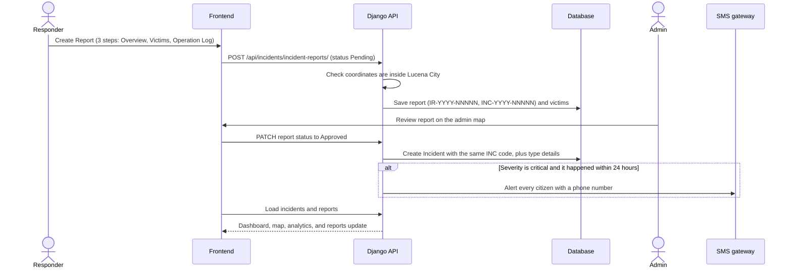
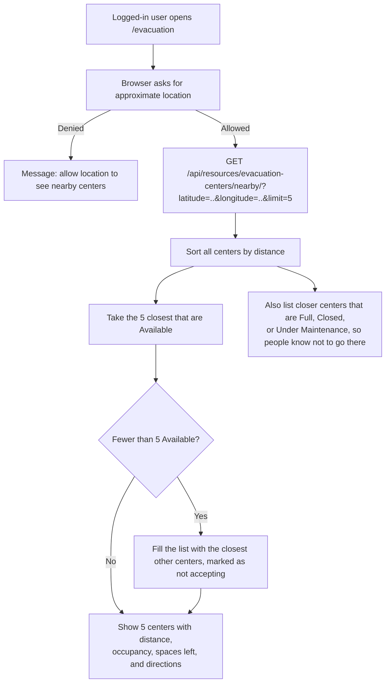

# Incident and Evacuation Flows

## From Responder Report to Incident

**When a report is approved** (`backend/incidents/signals.py`):

| Report incident type | Hazard type created |
|---|---|
| Fire Incident | Fire |
| RCA / vehicular / accident | Vehicular Accident |
| Crime Against Person/Property | Crime |
| Drowning | Drowning |
| Medical Emergency, Ambulance Assistance, Stand-by Medical Team | Medical Emergency |

| Severity | Rule |
|---|---|
| Critical | 5 or more victims |
| High | 3 or 4 victims |
| Moderate | Fire, drowning, or crime; or at least 1 victim |
| Low | Everything else |

The new incident gets status **Verified** and the report's barangay (or the nearest barangay to its coordinates). Only one incident is created per report, even if it is approved again.

**Accomplishment reports:** responders compile their approved reports into an accomplishment report (`POST /api/incidents/accomplishment-reports/`). Admins see these on the Accomplishment page and can print or export them.

## Nearest Evacuation Centers

Only logged-in users get recommendations. Logged-out visitors see the map of all centers.

**Status rules** (`backend/resources/evacuation.py`, applied every time a center is saved):

| Situation | Status |
|---|---|
| Capacity is set and occupancy reaches capacity | Full (automatic) |
| Capacity is set and occupancy is below capacity | Available (automatic) |
| Admin sets Closed or Under Maintenance | Kept as set, never changed automatically |
| Capacity not set (0) | Whatever the admin chose; residents see "Capacity not set" |

Occupancy can never be saved higher than capacity. If the `/nearby/` request fails, the browser works out the same list from the full center list.